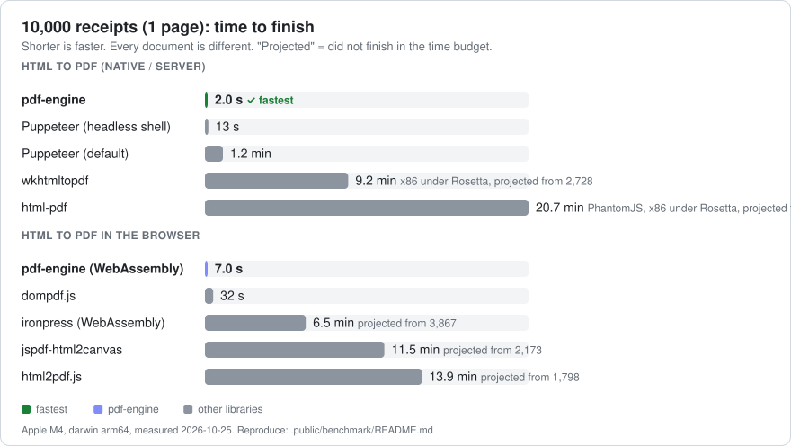
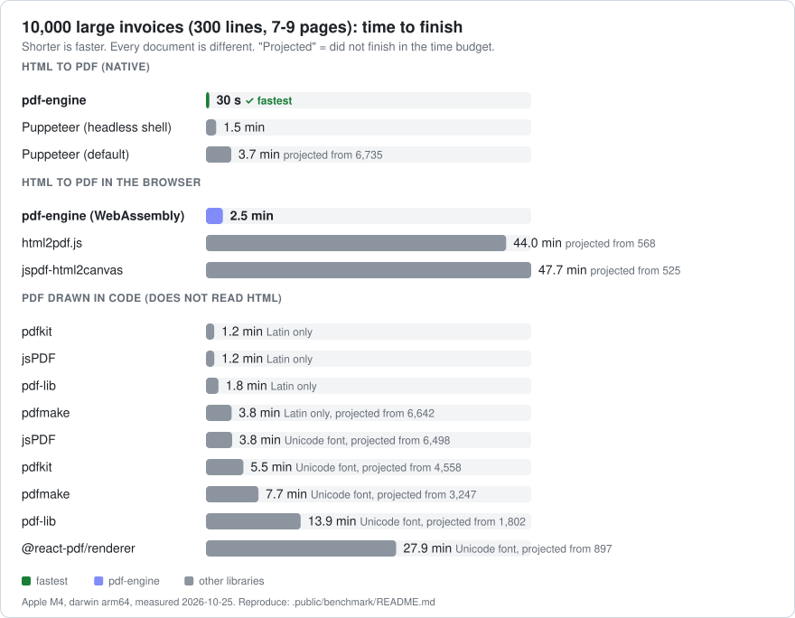
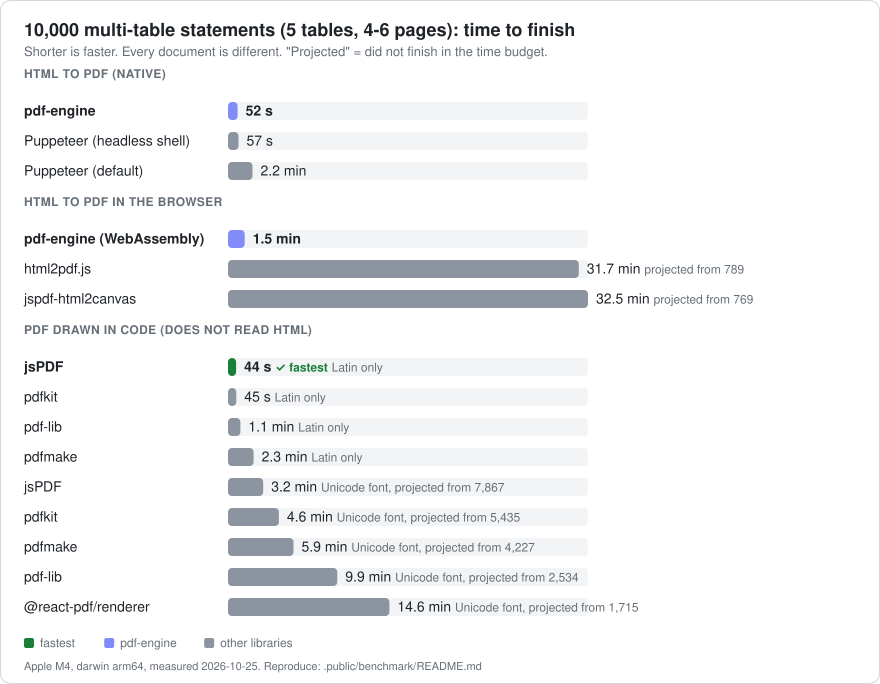
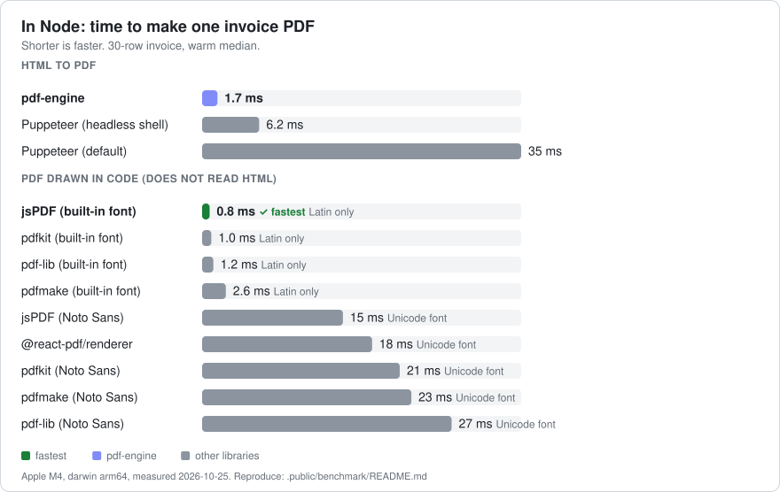
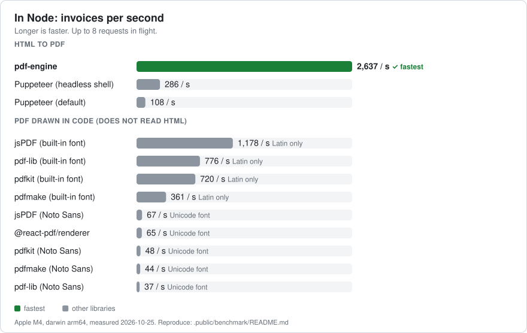
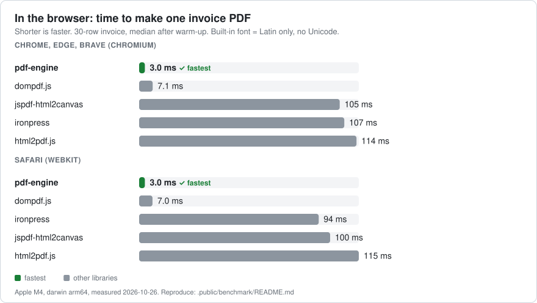
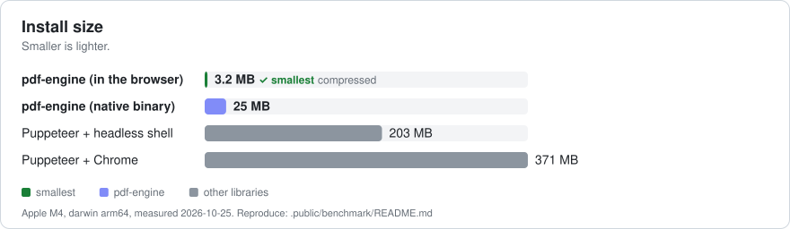
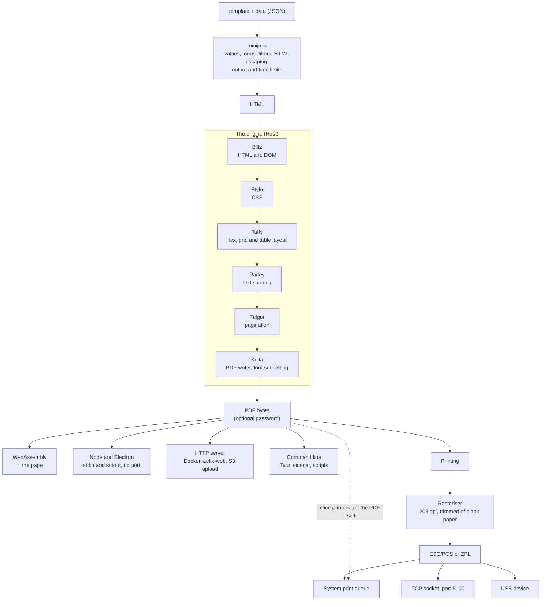

<p align="center"></p>

<p align="center">
  <a href="https://www.npmjs.com/package/@lands-horizon-corp/pdf-engine-wasm"></a>
  <a href="https://hub.docker.com/r/zalven88/pdf-engine"></a>
  <a href="https://github.com/Lands-Horizon-Corp/pdf-engine/actions"></a>
  
  
  
  
  
  <a href="#license"></a>
</p>

<p align="center"><strong>Turn HTML templates into real PDFs, fast, anywhere.</strong></p>
<p align="center">In the browser, in Electron and Tauri, on a server, or from the command line, with one Rust engine.<br/>
Print receipts and labels straight to the printer. No headless Chrome. Vector text, not screenshots.</p>

<p align="center">
  <a href="https://lands-horizon-corp.github.io/pdf-engine/"><strong>Live demo</strong></a> •
  <a href="#quick-start">Quick start</a> •
  <a href="#why-pdf-engine">Why</a> •
  <a href="#benchmarks">Benchmarks</a> •
  <a href="#install">Install</a> •
  <a href="#api-at-a-glance">API</a> •
  <a href="#printing">Printing</a> •
  <a href="#how-it-works">How it works</a> •
  <a href="#documentation">Docs</a> •
  <a href="https://github.com/Lands-Horizon-Corp/pdf-engine/issues">Issues</a>
</p>

**[Try it in your browser: edit a template and watch the PDF appear →](https://lands-horizon-corp.github.io/pdf-engine/)** No install, nothing uploaded: it runs the WebAssembly build, with a speed test.

---

## Quick start

```bash
npm install @lands-horizon-corp/pdf-engine-wasm
```

```ts
import { PDFEngine } from '@lands-horizon-corp/pdf-engine-wasm';

const pdf = new PDFEngine();                       // create once, reuse

// A template (HTML with placeholders) + data = a PDF
const bytes = await pdf.generate({
  template: `<h1>Invoice {{ no }}</h1>
             <ul><li>{{ item.name }}: ₱{{ item.price }}</li></ul>`,
  data: { no: '12345', items: [{ name: 'Hosting', price: 1500 }, { name: 'Domain', price: 450 }] },
});

await pdf.download({ template, data }, 'invoice.pdf');   // save it
await pdf.open({ template, data });                      // show it in a new tab
await pdf.print({ template, data });                     // browser print dialog

// Page setup, password, images
await pdf.generate({ template, data, width: '210mm', height: '297mm', password: 'secret',
                     images: { logo: fileInput.files[0] } });

// Render on your own server, and fall back to the page when offline
const hybrid = new PDFEngine({ url: ['https://pdf-1.example.com', 'https://pdf-2.example.com'], token: '…', pick: 'auto' });
```

On Electron or Node, the same call runs the native engine, and can print:

```ts
import { PDFEngine } from '@lands-horizon-corp/pdf-engine';

const pdf = new PDFEngine();
const bytes = await pdf.generate({ template, data });                       // a Buffer
const printers = await pdf.printers();                                     // USB, network and system printers
await pdf.print({ printerId: printers[0].id, paper: '58mm', template, data });   // ESC/POS to a receipt printer
```

No bundler? One `<script type="module">` is enough ([CDN guide](.public/docs/browser-api.md#bundlers-and-the-cdn)):

```html
<script type="module">
  import { PDFEngine } from 'https://cdn.jsdelivr.net/npm/@lands-horizon-corp/pdf-engine-wasm@1/index.js';
  new PDFEngine().download({ template: '<h1>Hello {{ name }}</h1>', data: { name: 'world' } }, 'hello.pdf');
</script>
```

---

## Why pdf-engine?

Turning HTML into a PDF on the web has always meant picking your trade-off:

| The usual way | What you give up |
| --- | --- |
| **A server with headless Chrome** (Puppeteer, Playwright) | A Node backend just to make PDFs, and 200 to 370 MB of Chromium to install, deploy and keep running |
| **A screenshot in the browser** (html2pdf.js, jspdf-html2canvas: html2canvas + jsPDF) | The PDF is a picture of the page: text cannot be selected or searched, it blurs when zoomed, and it is slow (70 to 100 ms per page here) |
| **Older engines** (html-pdf on PhantomJS, wkhtmltopdf) | Abandoned: PhantomJS development ended in 2018, `html-pdf` is deprecated on npm, the npm wrapper for `wkhtmltopdf` has not been updated since 2022 and the project is archived |

pdf-engine is a real layout engine (Blitz, Stylo, Taffy, Parley and Krilla, in Rust) compiled to WebAssembly. It runs
**inside the page**: no server, no Chromium, no PhantomJS, no round trip, works offline. The PDF has real vector
text, in 1 to 3 ms. The same engine also runs natively in Electron, Tauri and Docker when you want a server.

| HTML to PDF | pdf-engine | dompdf.js | ironpress | Puppeteer | html2pdf.js | jspdf-html2canvas | html-pdf | wkhtmltopdf |
|---|:-:|:-:|:-:|:-:|:-:|:-:|:-:|:-:|
| Takes HTML and CSS (flexbox, grid, tables) | ✅ | ✅ | ✅ | ✅ | ✅ | ✅ | ✅ | ✅ |
| Text stays text (selectable, searchable) | ✅ | ✅ | ✅ | ✅ | ❌ picture | ❌ picture | ✅ | ✅ |
| Runs in the browser, no server | ✅ | ✅ | ✅ | ❌ | ✅ | ✅ | ❌ | ❌ |
| Download in the browser (compressed) | 3.3 MB | **0.17 MB** | 4.7 MB | n/a | 0.26 MB | 0.25 MB | n/a | n/a |
| Maintained | ✅ | ✅ | ✅ | ✅ | ✅ | ✅ | ❌ deprecated | ❌ since 2022 |
| Time for a receipt, in the browser<sup>1</sup> | **1.3 ms** | 2.8 ms | 40 ms | n/a | 86 ms | 76 ms | n/a | n/a |
| Time for a 30-line invoice, in the browser<sup>1</sup> | **3.0 ms** | 7.2 ms | 109 ms | n/a | 114 ms | 106 ms | n/a | n/a |
| First PDF after the page loads<sup>1</sup> | 190 ms | **50 ms** | 165 ms | n/a | 130 ms | 110 ms | n/a | n/a |
| Prints to receipt and label printers | ✅ | ❌ | ❌ | ❌ | ❌ | ❌ | ❌ | ❌ |

<sub>1. Chromium on an Apple M4, median after warm-up ([benchmarks](#benchmarks)); WebKit gives the same order. dompdf.js
starts faster and downloads far less than pdf-engine; pdf-engine makes each document 2 to 2.5 times faster once running.
ironpress is run as WebAssembly with a generic font family, which is faster for it than a named font (a named font
about doubles its time); its native Rust build is faster than its WebAssembly build and was not measured. Puppeteer,
html-pdf and wkhtmltopdf need a server, so a browser time does not apply: on a server a receipt takes 4.7 ms with
Puppeteer (fastest mode), 356 ms with wkhtmltopdf and 413 ms with html-pdf (both x86 builds under Rosetta on this Mac,
so slower than they would be natively), against 0.9 ms here. Puppeteer renders everything Chrome can, including
JavaScript, which pdf-engine does not run; ironpress also does math, `@font-face` and bookmarks, which pdf-engine does
not; see the [CSS gaps](.public/docs/templates.md#css). pdf-engine is new and has no track record yet.</sub>

**What you get**

- 📄 **Real PDFs.** Vector text in tens of KB. Flexbox, grid, tables, gradients, transforms, SVG, CSS variables,
  `calc()`, page breaks, multi-column, and `@page` margin boxes.
- ⚡ **Fast.** About 1 ms per receipt and 3 ms per 30-line invoice. [Numbers and graphs](#benchmarks), with the machine and
  the conditions (PhantomJS and wkhtmltopdf run under Rosetta on the test Mac).
- 🌍 **Every language.** About 150 Noto fonts on the server cover practically every living script (Chinese, Arabic,
  Hindi, Thai, emoji, ...); in the browser you add the font you need.
- 🧩 **Templates built in.** `{{ value }}`, loops, conditions, filters, macros; HTML-escaped by default.
- 🖼️ **Images.** PNG, JPEG and GIF from URLs, files, `data:` URIs or bytes (and inline `<svg>` elements). A bad image is skipped, never an error.
- 🖨️ **Printing.** Receipts as ESC/POS, labels as ZPL, documents as PDF; through the system queue, a network socket or
  USB. Electron, Node and Tauri.
- 🔀 **Browser or server, your choice.** Several servers with failover, `pick: 'auto'` by size, and a fallback to
  WebAssembly when offline.
- 🔐 **Password encryption.** Set `password` and the PDF is encrypted.
- 🧭 **Errors you can act on.** A stable `code`, the template `line` and a `hint`.
- 🔒 **Safe by default.** Output and execution limits stop runaway templates; images load only from hosts you allow.

---

## Benchmarks

Every library makes the same documents, on one machine, with every document different. Charts and tables
below are generated from the saved results in [`.public/benchmark/results`](.public/benchmark/results); you can run them yourself
with `make bench-scale` ([how, and what is measured](.public/benchmark/README.md)).

<!-- bench:start -->
<!-- Generated by .public/benchmark/charts.mjs (npm run charts). Do not edit by hand. -->

### 10,000 documents, every library

Each library makes 10,000 different documents (or runs for 150 s, then the time is projected). Time to finish, three kinds of document:

#### Receipts (8 lines, 1 page)

<picture>
  <source media="(prefers-color-scheme: dark)" srcset=".public/benchmark/charts/scale-time-small-dark.svg">
  
</picture>

#### Large invoices (300 lines, 7-9 pages)

<picture>
  <source media="(prefers-color-scheme: dark)" srcset=".public/benchmark/charts/scale-time-large-dark.svg">
  
</picture>

#### Multi-table statements (5 tables of 35 lines, 4-6 pages)

<picture>
  <source media="(prefers-color-scheme: dark)" srcset=".public/benchmark/charts/scale-time-multitable-dark.svg">
  
</picture>

<details>
<summary>All the numbers</summary>

**Receipts** (8 lines, 1 page)

| Library | Finished | Time for 10,000 | Documents / second | Pages |
| --- | ---: | ---: | ---: | ---: |
| pdf-engine | 10,000 | 2.0 s | 5,047 | 1 |
| pdf-engine (WebAssembly) | 10,000 | 7.0 s | 1,436 | 1 |
| Puppeteer (headless shell) | 10,000 | 13 s | 753 | 1 |
| dompdf.js | 10,000 | 32 s | 315 | 1 |
| Puppeteer (default) | 10,000 | 1.2 min | 145 | 1 |
| ironpress | 3,867 | 6.5 min (projected) | 26 | 1 |
| wkhtmltopdf | 2,728 | 9.2 min (projected) | 18 | 1 |
| jspdf-html2canvas | 2,173 | 11.5 min (projected) | 14 | 1 |
| html2pdf.js | 1,798 | 13.9 min (projected) | 12 | 1 |
| html-pdf (PhantomJS) | 1,214 | 20.7 min (projected) | 8 | 1 |

**Large invoices** (300 lines, 7-9 pages)

| Library | Finished | Time for 10,000 | Documents / second | Pages |
| --- | ---: | ---: | ---: | ---: |
| pdf-engine | 10,000 | 33 s | 305 | 7 |
| Puppeteer (headless shell) | 10,000 | 1.4 min | 120 | 7 |
| pdf-engine (WebAssembly) | 10,000 | 2.2 min | 76 | 7 |
| Puppeteer (default) | 8,422 | 3.0 min (projected) | 56 | 7 |
| wkhtmltopdf | 2,384 | 10.5 min (projected) | 16 | 7 |
| dompdf.js | 1,993 | 12.5 min (projected) | 13 | 7 |
| html-pdf (PhantomJS) | 1,117 | 22.4 min (projected) | 7 | 9 |
| html2pdf.js | 566 | 44.2 min (projected) | 4 | 7 |
| jspdf-html2canvas | 521 | 48.1 min (projected) | 3 | 7 |
| ironpress | 153 | 2.7 h (projected) | 1 | 8 |

**Multi-table statements** (5 tables of 35 lines, 4-6 pages)

| Library | Finished | Time for 10,000 | Documents / second | Pages |
| --- | ---: | ---: | ---: | ---: |
| pdf-engine | 10,000 | 19 s | 528 | 5 |
| Puppeteer (headless shell) | 10,000 | 57 s | 176 | 5 |
| pdf-engine (WebAssembly) | 10,000 | 1.3 min | 125 | 5 |
| Puppeteer (default) | 10,000 | 2.2 min | 77 | 5 |
| dompdf.js | 3,166 | 7.9 min (projected) | 21 | 5 |
| wkhtmltopdf | 2,520 | 9.9 min (projected) | 17 | 5 |
| html-pdf (PhantomJS) | 1,165 | 21.6 min (projected) | 8 | 6 |
| html2pdf.js | 797 | 31.4 min (projected) | 5 | 5 |
| jspdf-html2canvas | 767 | 32.6 min (projected) | 5 | 5 |
| ironpress | 257 | 1.6 h (projected) | 2 | 6 |

Machine: Apple M4, 10 cores, darwin arm64, Node v26.10.0, 2026-10-26.

</details>

### Speed per document

<picture>
  <source media="(prefers-color-scheme: dark)" srcset=".public/benchmark/charts/node-time-dark.svg">
  
</picture>

<picture>
  <source media="(prefers-color-scheme: dark)" srcset=".public/benchmark/charts/node-throughput-dark.svg">
  
</picture>

<picture>
  <source media="(prefers-color-scheme: dark)" srcset=".public/benchmark/charts/browser-time-dark.svg">
  
</picture>

<picture>
  <source media="(prefers-color-scheme: dark)" srcset=".public/benchmark/charts/install-size-dark.svg">
  
</picture>

<!-- bench:end -->

---

## Install

| Package | For | Install |
| --- | --- | --- |
| [`@lands-horizon-corp/pdf-engine-wasm`](.node/wasm/README.md) | Web pages, React, Vue, Svelte, Next.js, Tauri frontends, plain HTML | `npm install @lands-horizon-corp/pdf-engine-wasm` |
| [`@lands-horizon-corp/pdf-engine`](.node/desktop/README.md) | Electron, Node, desktop apps: PDFs and printing | `npm install @lands-horizon-corp/pdf-engine` (not published yet) |
| [`zalven88/pdf-engine`](https://hub.docker.com/r/zalven88/pdf-engine) | A server your apps call over HTTP | `docker run -p 6767:6767 -e API_BEARER_TOKEN=secret zalven88/pdf-engine` |
| `pdf-engine` binary | Command line, Tauri sidecar, other languages | `cargo build --release` |

Pick your framework: [React](.public/docs/sample-react.md) · [Vue](.public/docs/sample-vue.md) ·
[Svelte](.public/docs/sample-svelte.md) · [Next.js](.public/docs/sample-nextjs.md) ·
[Electron](.public/docs/sample-electron.md) · [Tauri](.public/docs/sample-tauri.md) · [plain HTML](.public/docs/getting-started.md#in-a-web-page-no-build-step).

With Vite, keep the browser package out of dependency pre-bundling (one line):
`optimizeDeps: { exclude: ['@lands-horizon-corp/pdf-engine-wasm'] }`.

---

## API at a glance

**Browser package** ([full reference](.public/docs/browser-api.md))

| Method | Does |
| --- | --- |
| `new PDFEngine(options?)` | Create once and reuse. Options: `fonts`, `url`, `token`, `pick`, `autoMaxBytes`, `fallback`, `workers`, `partials`, `compression`, `pruneData`, `onImageError`, ... |
| `generate({ template, data, ... })` | Returns the PDF as a `Uint8Array`. Also `password`, `width`, `height`, `orientation`, `images` |
| `download(options, filename)` | Makes the PDF and saves it |
| `open(options)` | Shows the PDF in a new tab |
| `print(options)` | Opens the browser's print dialog |
| `ping()` | Loads the engine now, returns its version |
| `loadFonts(fonts)` | Use these fonts from now on |
| `preview(options, view)` | Shows a live preview with box outlines; `update()` redraws |
| `close()` | Release memory |

**Node and Electron package** ([full reference](.public/docs/desktop-api.md))

| Method | Does |
| --- | --- |
| `new PDFEngine(options?)` | Options: `fonts`, `binary`, `timeoutMs`, `imageDir`, `imageHosts`, `env`, `onLog` |
| `generate({ template, data, ... })` | Returns the PDF as a `Buffer` |
| `printers()` | Lists the printers: the system's and USB; print to a network one with `net://host:9100` |
| `print({ printerId, template, data, paper, ... })` | Renders and prints: ESC/POS, ZPL or PDF |
| `ping()`, `loadFonts()`, `reloadFonts()`, `close()`, `pid` | Housekeeping |

**Server** ([HTTP reference](.public/docs/http-api.md)): `POST /api/to-bytes` (the PDF), `POST /api/to-s3` (upload, get a link),
`POST /api/fonts/reload`, `GET /health`.
**Command line** ([reference](.public/docs/cli-and-ipc.md)): `pdf-engine serve | ipc | printers | print | healthcheck`.

Everything is typed (`generate<MyData>()` checks the shape of your data).

---

## Printing

Receipt (thermal) printers get **ESC/POS**, label printers get **ZPL**, office printers get the **PDF**:

```ts
const pdf = new PDFEngine();

await pdf.printers();
// [{ id: 'system://POS-58', name: 'POS-58', type: 'thermal', status: 'ready', transport: 'system', default: false },
//  { id: 'usb://0483:5740', name: 'USB printer 0483:5740', type: 'thermal', transport: 'usb', ... }]
// A network printer is not in that list (it cannot be discovered): print to it by its address.
// await pdf.print({ printerId: 'net://192.168.1.150:9100', paper: '80mm', template, data });

await pdf.print({
  printerId: 'system://POS-58',
  paper: '58mm',                                   // '58mm', '80mm' (default), '112mm', or dots
  template: '<b>STORE</b><div>{{ i.name }} ₱{{ i.price }}</div><b>TOTAL ₱{{ total }}</b>',
  data: { items: [{ name: 'Sardines', price: 24.5 }], total: 24.5 },
});
```

| Id | Reaches the printer through |
| --- | --- |
| `system://<name>` | The operating system's print queue (CUPS, Windows spooler): any printer with a driver, USB or network |
| `net://host:9100` | A TCP socket straight to a network printer |
| `usb://vendor:product` | The USB device directly, pure Rust, no libusb |

The receipt is rendered like any other template (so ₱, Arabic and CSS all work), rasterised at 203 dpi, trimmed of
blank paper, and sent with a cut. Tauri and scripts use the same thing from the command line:
`pdf-engine print --request job.json`. [Printing guide](.public/docs/printing.md) · Not yet tried on physical printers:
it is verified against fake network printers on Linux, macOS and Windows, and through the Windows print spooler.

---

## How it works



- **One engine, many doors.** The browser build compiles the same Rust source files as the server; templates, CSS and
  error codes match everywhere.
- **Fast on purpose.** Fonts and style data are shared across documents, memory is bounded, and the WebAssembly build
  is tuned for speed. The patched dependencies are in `vendor/`, each with a `PATCHES.md` saying what and why.
- **Safe on purpose.** No JavaScript runs in templates; output size and execution are capped; remote images load only
  from hosts you allow; server error details stay in the log.

---

## Documentation

| | |
| --- | --- |
| [Getting started](.public/docs/getting-started.md) | Your first PDF in a web page, React, Electron, a server or the command line |
| [Templates and CSS](.public/docs/templates.md) | The template language, filters (and the ones that do not exist), page size, CSS support and gaps, images |
| [Browser package](.public/docs/browser-api.md) | Every option and method, routing between servers and the page |
| [Node and Electron package](.public/docs/desktop-api.md) | Every option and method, binary lookup, errors |
| [Printing](.public/docs/printing.md) | Printers, ids, paper sizes, ESC/POS and ZPL, USB, Windows notes |
| [HTTP server](.public/docs/http-api.md) | Endpoints, form fields, settings, S3, Docker |
| [Command line and IPC](.public/docs/cli-and-ipc.md) | The commands and the wire protocol, to write a client in any language |
| [Fonts and languages](.public/docs/fonts-and-languages.md) | Scripts covered, adding fonts |
| [Errors](.public/docs/errors.md) | Every code and what to do about it |
| Guides | [React](.public/docs/sample-react.md) · [Vue](.public/docs/sample-vue.md) · [Svelte](.public/docs/sample-svelte.md) · [Next.js](.public/docs/sample-nextjs.md) · [Electron](.public/docs/sample-electron.md) · [Tauri](.public/docs/sample-tauri.md) |

---

## How it compares to what is on npm

The packages that turn **HTML into a PDF**. Figures are live from the npm registry
(`node .public/benchmark/npm-stats.mjs`, 2026-10-24).

| Package | Weekly downloads | Updated | Runs in | How it makes the PDF | Takes HTML? |
| --- | ---: | --- | --- | --- | --- |
| [puppeteer-core](https://www.npmjs.com/package/puppeteer-core) / [puppeteer](https://www.npmjs.com/package/puppeteer) | 14,783,400 / 7,126,067 | 2 days ago | Node | Drives headless Chrome | HTML + full CSS and JS |
| [html2pdf.js](https://www.npmjs.com/package/html2pdf.js) | 755,107 | 10 months ago | Browser | Draws the page to an image (html2canvas), then jsPDF | HTML + CSS |
| [jspdf-html2canvas](https://www.npmjs.com/package/jspdf-html2canvas) | 18,764 | 3 months ago | Browser | jsPDF + html2canvas | HTML + CSS |
| [dompdf.js](https://www.npmjs.com/package/dompdf.js) | 372 | 26 days ago | Browser | Reads the page, draws vector text with its own WebAssembly engine | HTML + CSS |
| [ironpress](https://www.npmjs.com/package/ironpress) | 34 | 40 days ago | Browser, Node (and Rust, C, .NET, Java, Python, Ruby) | Rust renderer, compiled to WebAssembly or native | HTML + CSS, Markdown, math |
| [html-pdf](https://www.npmjs.com/package/html-pdf) | 74,278 | **deprecated** on npm | Node | PhantomJS (discontinued in 2018) | HTML + CSS |
| [wkhtmltopdf](https://www.npmjs.com/package/wkhtmltopdf) | 34,949 | 4 years ago (the binary is archived) | Node | Wraps the wkhtmltopdf binary | HTML + CSS |
| [@adobe/pdfservices-node-sdk](https://www.npmjs.com/package/@adobe/pdfservices-node-sdk) | 27,968 | 24 days ago | Node | Adobe's hosted service (account and network) | Via the service |
| **pdf-engine** | new | new | **Browser, Node, Electron, Tauri, HTTP** | **Rust renderer, compiled to WebAssembly or native** | **HTML + CSS (see [CSS](.public/docs/templates.md#css))** |

<sub>Downloads show adoption, not quality: Puppeteer is established and widely used, and pdf-engine is new with no
track record. They suit different jobs: Puppeteer renders anything Chrome can, including JavaScript, on a server;
pdf-engine turns HTML templates into documents quickly, in the browser or a server.</sub>

---

## Platform support

What has actually been run (CI runs on every push):

| | Status |
| --- | --- |
| **Linux** (Ubuntu) | Rust tests, Node client, browser package in Chromium, Firefox and WebKit, and the Docker test image with the production fonts |
| **macOS** | The same, plus the benchmarks |
| **Windows** | Build, all Rust tests, Node client, browser package under Node, and printing to a virtual receipt printer through the real print spooler |
| **Browsers** | Chromium and WebKit (Safari's engine) on macOS and Linux, Firefox on Linux. Edge and Brave are Chromium; real Safari and phones are not tested separately |
| **React, Vue, plain JS** | In the browser tests. Svelte, Next.js, Electron and Tauri guides are written but not run in tests yet |
| **Physical printers** | Not tried yet: checked against fake printers and a virtual one |

---

## Errors

Every failure has a stable `code`, a readable message, and where it helps a `hint` and the template `line`:

```json
{ "error": "Template rendering failed: syntax error (in <string>:3)", "code": "TEMPLATE_ERROR", "status": 400, "line": 3,
  "hint": "Check the template syntax: {{ value }}, ...." }
```

```ts
try { await pdf.generate({ template, data }); }
catch (e) { if (e instanceof PDFEngineError && e.code === 'TEMPLATE_ERROR') showError(e.line, e.hint); }
```

All codes, with what to do: [Errors](.public/docs/errors.md).

---

## HTTP and Docker

<details>
<summary>Run it, with or without storage</summary>

```bash
docker run -d -p 6767:6767 -e API_BEARER_TOKEN=secret zalven88/pdf-engine

curl -H "Authorization: Bearer secret" \
  --form-string 'template=<h1>Invoice {{ no }}</h1>' -F 'data={"no": 42}' \
  http://localhost:6767/api/to-bytes -o invoice.pdf
```

To use `POST /api/to-s3`, add `-e STORAGE_URL=... -e STORAGE_BUCKET=... -e STORAGE_ACCESS_KEY=... -e STORAGE_SECRET_KEY=...`
(any S3-compatible store). The repository's `docker-compose.yml` starts the server with its own storage
([RustFS](https://github.com/rustfs/rustfs)): `docker compose up`.

Settings, endpoints and form fields: [HTTP server](.public/docs/http-api.md). Set `CORS_ALLOWED_ORIGINS` to call it
from a browser, and change `API_BEARER_TOKEN` before exposing it.

</details>

---

## Development

<details>
<summary>Build, test, layout and release</summary>

```bash
make test       # functional test suites
make check      # fmt + tests (what CI runs)
make node       # Node client tests (cargo build first)
make bench      # speed per document, then redraw the charts
make help       # everything else
```

No Rust locally? Use the `docker-` variants (`make docker-test`, ...).

### Layout

The engine is Rust and lives at the top level; everything else is in dot folders so it sorts first.

| Path | What |
| --- | --- |
| `src/`, `tests/`, `vendor/` | The Rust engine, its tests, and the patched dependencies (each with a `PATCHES.md`) |
| `.node/wasm/` | The browser package (WebAssembly), its Rust crate and browser tests |
| `.node/desktop/` | The Node, Electron and Tauri package: IPC client, printing |
| `.public/assets/` | Fonts shared by the Docker image and the browser package, and the logo |
| `.public/docs/` | The documentation and framework guides |
| `.public/benchmark/` | The benchmarks, charts and results ([guide](.public/benchmark/README.md)) |
| `.public/scripts/` | Release, push and Windows test scripts |

### Release

[PUBLISHING.md](PUBLISHING.md) is the checklist. In short: bump the version in `Cargo.toml` and the two
`package.json` files, add a [CHANGELOG.md](CHANGELOG.md) entry, commit, then push a tag `vX.Y.Z`. GitHub builds and
tests the browser package, publishes it to npm, and pushes the Docker image (amd64 and arm64).

</details>

---

## Contributing

1. Fork the repo and create a branch.
2. Make your change with tests (`make check` must pass).
3. Open a pull request. CI runs Linux, macOS, Windows and the browsers.

Bugs and ideas: [Issues](https://github.com/Lands-Horizon-Corp/pdf-engine/issues).

---

## Roadmap

Planned, not built yet:

- [ ] Publish the Node/Electron package with the engine binary for every platform
- [ ] Verify printing on physical receipt, label and office printers
- [x] Reusable template **partials**, ``, and `<barcode>` / QR tags drawn as vector shapes
- [ ] Repeating `<thead>` on later pages
- [x] `rowspan`
- [ ] `@font-face` and `float`
- [x] A live layout preview with box outlines (`pdf.preview()`), a Web Worker pool (`workers`), and React, Vue and Svelte helpers

---

## Keywords

`pdf` `html-to-pdf` `pdf-generator` `invoice` `receipt` `thermal-printer` `escpos` `zpl` `label-printer` `wasm`
`webassembly` `rust` `electron` `tauri` `react` `vue` `svelte` `nextjs` `templates` `puppeteer-alternative`
`html2pdf-alternative` `jspdf-alternative` `no-chromium` `docker` `offline`

---

## License

[MIT](./LICENSE). Rendering by [Fulgur](https://github.com/fulgur-rs/fulgur) (MIT/Apache-2.0) on Blitz, Stylo,
Taffy, Parley and Krilla; fonts by [Noto](https://fonts.google.com/noto) (OFL).

<p align="center">Made by <a href="https://github.com/Lands-Horizon-Corp">Lands Horizon</a></p>
